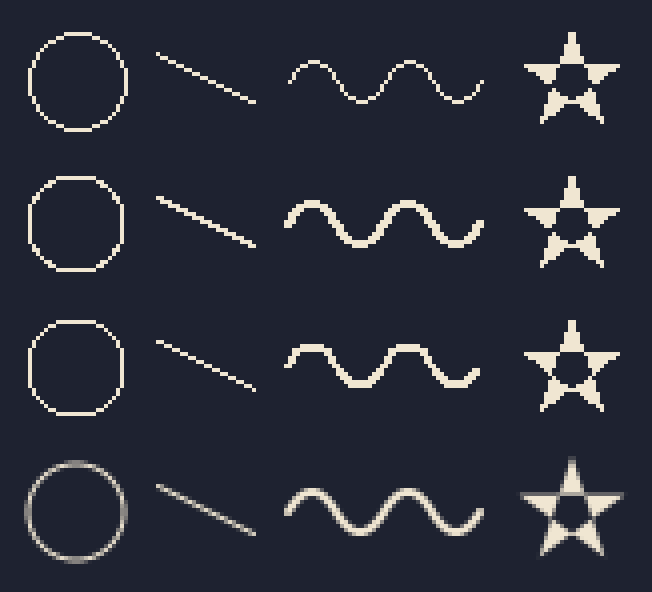

# ai-draw

Vector drawing for Python with two outputs from the same paths: **pixel art** that keeps the
pixel artist's rules, and **smooth**, antialiased art.



*Rows, top to bottom: `skimage.draw`, a raw raster (the vector outline sampled at pixel
centers, no rules), ai-draw pixel, ai-draw smooth. Columns: a 1-px circle, a 1-px 1:2 line, a
2-px wave, an even-odd star. Shown 4 times larger.*

## Why

Rasterizing vectors at low resolution, every pixel all or nothing, produces what pixel
artists spend their time fixing: L corners that make a line look doubled, steps out of order,
strokes that swell and thin, loose pixels, thin tips that break off. ai-draw's pixel output
draws the same paths and keeps those rules. Its smooth output gives each pixel the exact
share of its area inside the shape.

Each rule is a detector that counts its violations
([`ai_draw.pixel.defects`](src/ai_draw/pixel/defects.py)); 0 is clean. A fixed bench measures
the rasterizer with them, and its score can only go down. On the bench shapes today:

| shape | check | skimage.draw | raw raster | ai-draw pixel |
|---|---|---:|---:|---:|
| 1-px circles, r 3-16 | L corners | 8 | 168 | 0 |
| 1-px circles, r 3-16 | wobble | 40 | 80 | 0 |
| 1-px circles, r 3-16 | extra pieces | 0 | 0 | 0 |
| 1-px lines, 1:1 to 1:6 | L corners | 0 | 48 | 0 |
| 1-px lines, 1:1 to 1:6 | uneven steps | 0 | 0 | 0 |
| 2-px wave | wobble | — | 10 | 0 |
| 2-px wave | thickness | — | 0 | 0 |
| even-odd star | extra pieces | 1 | 1 | 0 |

Generated by `uv run python docs/gallery/scores.py`. A test fails when this table or the
picture above no longer matches what the library draws.

## Install

```bash
pip install git+https://github.com/mateuscamp/ai-draw
```

Python 3.11 or newer; it needs numpy and Pillow.

## Use

```python
from pathlib import Path

from ai_draw.geometry.path import ellipse
from ai_draw.grid.canvas import Canvas
from ai_draw.io.png import write_png
from ai_draw.pixel.stroke import stroke as pixel_stroke
from ai_draw.smooth.stroke import stroke as smooth_stroke

ring = ellipse(16, 16, 12)
cream = (240, 230, 210, 255)

pixel = Canvas(32, 32)
pixel_stroke(pixel, ring, cream, 2)
write_png(pixel.enlarged(8), Path("ring_pixel.png"))

smooth = Canvas(32, 32)
smooth_stroke(smooth, ring, cream, 2)
write_png(smooth.enlarged(8), Path("ring_smooth.png"))
```

A scene is a Python file with a `draw()` that returns a `Canvas`; the command line runs it:

```bash
ai-draw render examples/pixel/coin.py --scale 10
ai-draw watch examples/pixel/potion.py --scale 10
ai-draw palette examples/pixel/coin.py --near 10
ai-draw lint sprite.png --line '#26202e'
```

`watch` redraws on every save and shows the picture in [imv](https://sr.ht/~exec64/imv/).
`lint` counts pixel-art defects in any PNG, drawn by hand, by an AI or by ai-draw, and exits
with 1 when it finds one, so it can guard a build.

## What is in it

- **geometry**: paths with lines and quadratic and cubic Bézier curves, polygons, rectangles,
  ellipses, affine transforms.
- **pixel**: fill sampled at pixel centers (nonzero and even-odd), with thin parts kept
  joined; a one-pixel line without L corners, with its steps in order and mirror-symmetric;
  strokes N pixels wide, a brush stamped along that line; the defect detectors.
- **smooth**: exact area coverage (the method of font-rs), and strokes with round caps and
  joins. Within 1/255 of FreeType drawing the same path 32 times larger, averaged back.
- **grid**: the canvas, sprites from character maps, the computed outline, closed palettes
  in families with quantization, diff and recolor.
- **examples**: [`examples/pixel`](examples/pixel) (each with its closed palette, which a test
  enforces) and [`examples/smooth`](examples/smooth).

## Limits

- Below about 20 pixels no rule replaces choosing pixel by pixel; draw that detail as a
  character map, as in [`examples/pixel/potion.py`](examples/pixel/potion.py).
- Large one-pixel circles read slightly octagonal: the step from the flat top to the first
  diagonal is abrupt. No detector measures roundness yet. `skimage.draw`'s Bresenham circle
  reads rounder, with the L corners and wobble counted above.
- A smooth stroke keeps the inner side of a corner sharp; a turn tighter than the stroke
  width overlaps itself there.

## How it is made

Test first: every test is seen failing before the code that passes it. basedpyright runs in
its strictest mode and Ruff with all rules. The decisions, in Portuguese, are in
[`docs/adr`](docs/adr) and [`PLANO.md`](PLANO.md); the architecture rules they set are tests
in [`tests/architecture`](tests/architecture).

## License

[GPL-3.0-only](LICENSE).
